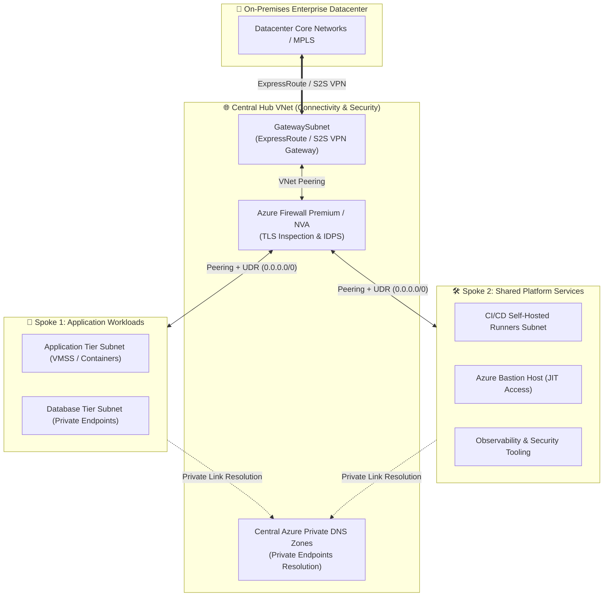
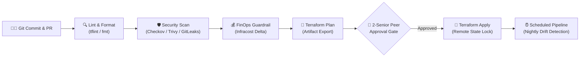
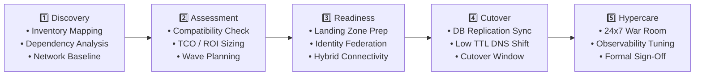
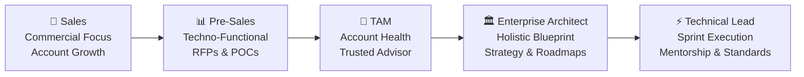
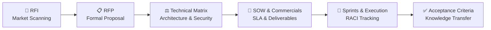

<div align="center">

  <!-- Header Banner -->
  

  <!-- Animated Typing Headline -->
  <a href="https://github.com/ravinder-singh-qa">
    
  </a>

  <p align="center">
    <strong>Architecting Resilient Multi-Cloud Foundations &bull; Automating Enterprise DevSecOps &bull; Driving Cloud FinOps</strong>
  </p>

  <!-- Status & Quick Links Badges -->
  <p align="center">
    <a href="mailto:singh_ravinder86@yahoo.com"></a>
    <a href="https://linkedin.com/in/ravinder-singh-qa"></a>
    
    
  </p>

</div>

---

## ⚡ Executive Summary & Leadership Impact

I am a **Senior Cloud & DevOps Architect** specializing in architecting, automating, and securing enterprise-scale cloud platforms. My focus bridges **strategic business vision** with **hands-on engineering execution**—delivering production-grade Infrastructure as Code (IaC), zero-trust security postures, autonomous CI/CD pipelines, and FinOps governance.

I lead digital transformations from the ground up: designing compliant **Microsoft Cloud Adoption Framework (CAF)** Landing Zones, executing complex hybrid data center migrations of **100+ critical enterprise workloads**, and optimizing multi-million dollar cloud operating budgets.

### 🏆 Key Career Milestones & Value Delivered

| Metric / Objective | Scope & Enterprise Impact | Core Technologies & Methodologies |
| :--- | :--- | :--- |
| **🚀 100+ Workload Migration** | Migrated 100+ enterprise applications from On-Premises to Azure with zero unplanned downtime and 99.99% availability. | Azure Migrate, ExpressRoute, Hub-and-Spoke, ASR, Database Migration Service |
| **💰 28% – 35% Cloud Cost Reduction** | Spearheaded enterprise FinOps initiatives, eliminating unattached assets, rightsizing compute, and deploying 1yr/3yr RIs. | Infracost, Azure Cost Management, Data Collection Rules (DCR), Automation Runbooks |
| **🛡️ Zero-Trust Security Posture** | Established multi-layered defense-in-depth with automated compliance (CIS Benchmarks, MCSB, ISO 27001). | Microsoft Entra ID, PIM, Conditional Access, Azure Firewall Premium, Checkov, Trivy |
| **⚙️ 100% IaC & Shift-Left DevSecOps** | Engineered reusable, hardened Terraform modules with nightly automated drift detection & state locking. | Terraform, Azure DevOps Pipelines, GitHub Actions, tflint, GitLeaks, Azure Blob Storage |

---

## 🏛️ The 10 Scalability & Quality Pillars

Every enterprise workload and platform I design is anchored on ten non-negotiable architectural pillars:

<div align="center">

```
+--------------------------------------------------------------------------------------------------+
|                                    10 Scalability & Quality Pillars                               |
|                                                                                                  |
|  1. Scalable      2. Robust        3. Secure        4. Reliable       5. Portable                |
|  6. Governed      7. High Avail    8. Cost-Optim    9. Backed Up      10. Compliant & Monitored  |
+--------------------------------------------------------------------------------------------------+
```

</div>

---

## 🛠️ Technical Competency & Ecosystem Matrix

<table width="100%">
  <tr>
    <td width="50%" valign="top">
      <h4>☁️ Cloud & Hybrid Infrastructure</h4>
      
      
      
      
      
      
    </td>
    <td width="50%" valign="top">
      <h4>📜 Infrastructure as Code & Automation</h4>
      
      
      
      
      
      
    </td>
  </tr>
  <tr>
    <td width="50%" valign="top">
      <h4>🔄 DevSecOps & CI/CD Pipelines</h4>
      
      
      
      
      
      
    </td>
    <td width="50%" valign="top">
      <h4>🌐 Networking, Identity & Zero-Trust</h4>
      
      
      
      
      
      
    </td>
  </tr>
  <tr>
    <td width="50%" valign="top">
      <h4>📈 Observability, Reliability & SRE</h4>
      
      
      
      
      
      
    </td>
    <td width="50%" valign="top">
      <h4>💰 FinOps & Governance</h4>
      
      
      
      
      
      
    </td>
  </tr>
</table>

---

## 📐 Enterprise Architecture Reference Blueprints

Below are core production blueprints reflecting battle-tested architectures implemented across enterprise environments.

---

### 1. Enterprise Hub-and-Spoke Networking Architecture

Centralized traffic inspection, hybrid connectivity, and isolated blast radiuses connecting On-Premises to Azure.



<details>
<summary><b>🔍 Architectural Deep Dive & Design Decisions</b></summary>

* **Zero Overlapping CIDRs (IPAM):** Comprehensive pre-migration IP assessment guaranteeing non-conflicting IP allocations between on-prem and cloud VNets.
* **Forced Tunneling via UDRs:** All spoke egress (`0.0.0.0/0`) and inter-spoke communications route strictly through Azure Firewall / NVA for packet inspection, URL filtering, and threat detection.
* **Private Link Ingestion:** PaaS services (Azure Key Vault, Storage Accounts, SQL Databases) communicate purely through Private Endpoints, eliminating public internet exposure.
* **Hybrid Name Resolution:** Hub-hosted Private DNS Zones linked across all spoke VNets with conditional forwarders syncing internal on-prem AD/DNS.
</details>

---

### 2. Enterprise Governance, Identity & Management Hierarchy

Designed under the **Microsoft Cloud Adoption Framework (CAF)** for multi-subscription isolation, regulatory guardrails, and role separation.

```
                            [ Microsoft Entra ID Tenant ]
                                          │
                              [ Tenant Root Group ]
                                          │
         ┌────────────────────────────────┼────────────────────────────────┐
         │                                │                                │
[ Platform Management Group ]   [ Landing Zones (Workloads) ]    [ Decommissioned / Sandbox ]
   ├── Identity (AD/DNS)           ├── Corp (Internal Only)         ├── Sandbox MG
   ├── Management (Logs/Mon)       ├── Online (Public/DMZ)          └── Decommissioned MG
   └── Connectivity (Hub/Firewall) ├── Dev Subscriptions
                                   ├── UAT Subscriptions
                                   └── Prod Subscriptions
```

<details>
<summary><b>🔍 Governance & Identity Controls</b></summary>

* **Subscription Blast Radius:** Strict segregation of environments (`Dev`, `UAT`, `Prod`) into distinct subscriptions to isolate blast radiuses and eliminate noisy-neighbor bottlenecks.
* **Guardrails as Code:** Azure Policy and Initiatives (e.g., CIS Azure Benchmark, Microsoft Cloud Security Benchmark) assigned at Management Group roots with `Deny` and `AuditIfNotExists` effects.
* **Just-In-Time Privilege (PIM):** No standing admin permissions. Privileged Identity Management (PIM) mandates ticket references, multi-factor authentication, and manager approvals for time-bound privilege elevation.
</details>

---

### 3. Production DevSecOps & Terraform CI/CD Automation Lifecycle

A fully automated, shift-left continuous delivery pipeline enforcing security, linting, cost estimation, and drift detection before code reaches production.



<details>
<summary><b>🔍 Pipeline Mechanics & Enterprise Standards</b></summary>

* **Trunk-Based Strategy:** Short-lived feature branches (`feature/*`, `fix/*`) gated by mandatory PR policies, minimum 2 senior approvals, and `CODEOWNERS` sign-off.
* **Shift-Left Security:** Automated PR blockers on hardcoded secrets (`GitLeaks`) and infrastructure vulnerabilities (`Checkov`, `tfsec`, `Trivy`).
* **FinOps Visibility:** `Infracost` comments directly on pull requests displaying exact monthly expenditure impact before merge.
* **State Integrity:** Remote Terraform state stored in private Azure Blob Storage with lease locking, customer-managed key encryption, and managed identity RBAC.
* **Nightly Drift Detection:** Scheduled cron pipelines executing `terraform plan -detailed-exitcode` to immediately flag any out-of-band portal alterations.
</details>

---

### 4. 5-Phase End-to-End Cloud Migration Strategy (100+ Workloads)

Proven migration lifecycle ensuring seamless cutovers, continuous validation, and business continuity.



<details>
<summary><b>🔍 Migration Checklists & Phase Execution</b></summary>

* **Pre-Migration:** Comprehensive discovery using Azure Migrate and dependency agents. Sizing of ExpressRoute bandwidth, staging Azure Site Recovery (ASR) replication appliances, and establishing rollback runbooks.
* **Cutover Window:** Decreased DNS TTL to 300 seconds; freeze source transactions; finalize delta database replication; flip DNS records and execute automated smoke/sanity test suites.
* **Post-Migration & Hypercare:** 2 to 4 weeks dedicated war room support monitoring APM telemetry, CPU/Memory percentiles, user latency, and incident retrospectives.
</details>

---

### 5. Multi-Layered Defense-in-Depth Security Matrix

| Layer | Enterprise Controls & Applied Technologies |
| :--- | :--- |
| **🔑 Identity Layer** | Microsoft Entra ID, Conditional Access policies, FIDO2/MFA, Privileged Identity Management (PIM) with JIT access, Managed Identities (no hardcoded credentials). |
| **🌐 Network Layer** | Hub-and-Spoke topology, Micro-segmentation with NSGs & ASGs, Azure Firewall Premium with TLS inspection & IDPS, Private Endpoints, DDoS Protection. |
| **📋 Governance Layer** | Azure Policy initiatives (CIS Benchmarks, ISO 27001, MCSB), Microsoft Defender for Cloud Secure Score tracking, automated drift remediation. |
| **💻 Compute Layer** | Defender for Servers, automated vulnerability patching baselines, Customer Managed Keys (CMK) disk encryption, immutable VM custom images. |

---

### 6. FinOps (Cloud Financial Management) Framework

```
                          [ Continuous FinOps Lifecycle ]
                                         │
        ┌────────────────────────────────┼────────────────────────────────┐
        ▼                                ▼                                ▼
  [ Eliminate Waste ]              [ Rightsizing ]             [ Rate Optimization ]
  • Orphaned Managed Disks        • 30-Day P95 CPU/RAM         • 1-Yr / 3-Yr RIs
  • Obsolete Snapshots            • Downgrade Overprovisioned  • Azure Savings Plans
  • Unused Public IPs             • Dev/UAT Auto-Shutdown      • Spot Compute Workloads
```

* **Targeted Waste Elimination:** Automated cleanup scripts detecting unattached disks, unused IP addresses, orphaned NICs, and aged snapshot backups.
* **Dynamic Environment Scheduling:** Automated Start/Stop schedules for non-production environments outside standard operational hours (yielding ~65% savings on Dev/Test compute).
* **Telemetry & Ingestion Optimization:** Fine-tuned Azure Monitor Log Analytics using Data Collection Rules (DCR) to suppress debug and redundant event logs, drastically slashing monthly gigabyte ingestion overheads.

---

### 7. Backup, Disaster Recovery & High Availability (HA/DR)

* **Resilient Storage Architecture:**
  * **LRS (Locally Redundant):** 3 copies within a single datacenter for transient workloads.
  * **ZRS (Zone-Redundant):** Synchronously replicated across 3 availability zones in a region for critical state.
  * **GRS (Geo-Redundant):** Asynchronously replicated to paired regional secondary for catastrophic disaster recovery.
* **High Availability Compute:** Virtual Machine Scale Sets (VMSS) orchestrated across multi-AZ configurations behind Azure Load Balancer.
* **Business Continuity SLAs:**
  * **RTO (Recovery Time Objective):** System restoration target `< 1 Hour` for tier-1 production systems.
  * **RPO (Recovery Point Objective):** Continuous transactional replication guaranteeing `< 15 Minutes` potential data delta.
  * **Automated Failover:** Azure Site Recovery (ASR) configured across paired regional boundaries with scheduled quarterly disaster drills.

---

## 👔 The Senior Leadership Mindset: Strategic & Vendor Governance

In senior architectural and lead positions, technological excellence must directly support commercial and operational success.

### 🧭 Career Alignment Matrix



### 🤝 Vendor Management & Delivery Governance Lifecycle

Architects must evaluate, negotiate with, and govern vendor partners, system integrators, and software suppliers:



* **Statement of Work (SOW):** Authoring unambiguous deliverables, milestone schedules, acceptance criteria, warranty windows, and liability boundaries.
* **Technical Evaluation Matrix:** Quantifiable scoring models evaluating third-party solutions against security compliance, API maturity, total cost of ownership (TCO), and performance SLAs.
* **RACI Framework Enforcement:** Eliminating delivery ambiguity by defining **R**esponsible, **A**ccountable, **C**onsulted, and **I**nformed roles across every technical sprint.
* **Mentorship & Team Upskilling:** Leading architectural reviews, conducting Knowledge Transfer (KT) sessions, building internal runbooks, and serving on senior engineering interview panels.

---

## 📊 GitHub Analytics & Profile Activity

<div align="center">
  <table border="0">
    <tr>
      <td>
        
      </td>
      <td>
        
      </td>
    </tr>
    <tr>
      <td colspan="2" align="center">
        
      </td>
    </tr>
  </table>
</div>

---

## 💬 Let's Connect & Collaborate

Whether you are looking to architect resilient cloud infrastructure, execute complex hybrid migrations, optimize cloud expenditure, or exchange ideas on modern DevSecOps patterns, let's connect!

<div align="center">

  <a href="https://linkedin.com/in/ravinder-singh-qa">
    
  </a>
  &nbsp;&nbsp;
  <a href="mailto:singh_ravinder86@yahoo.com">
    
  </a>
  &nbsp;&nbsp;
  <a href="https://github.com/ravinder-singh-qa">
    
  </a>

</div>

<br/>

<div align="center">
  <sub>Designed with ❤️ for Enterprise Cloud Engineering & Architecture Excellence</sub>
</div>
